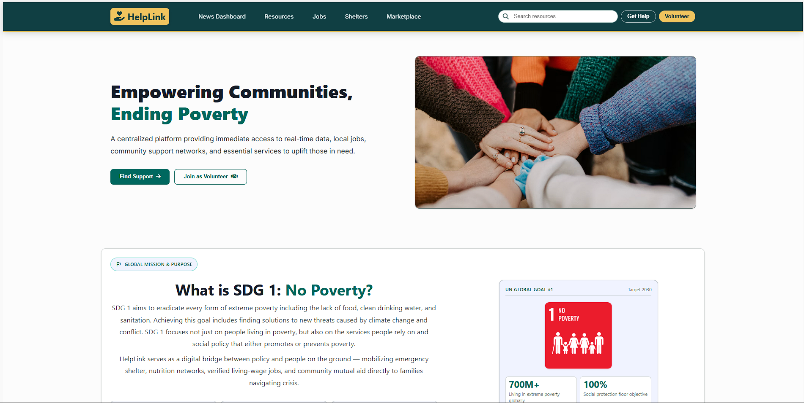
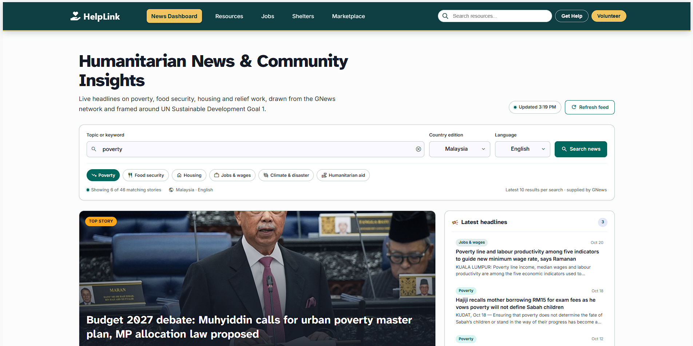
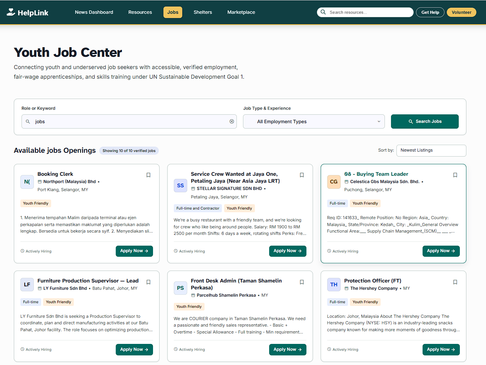
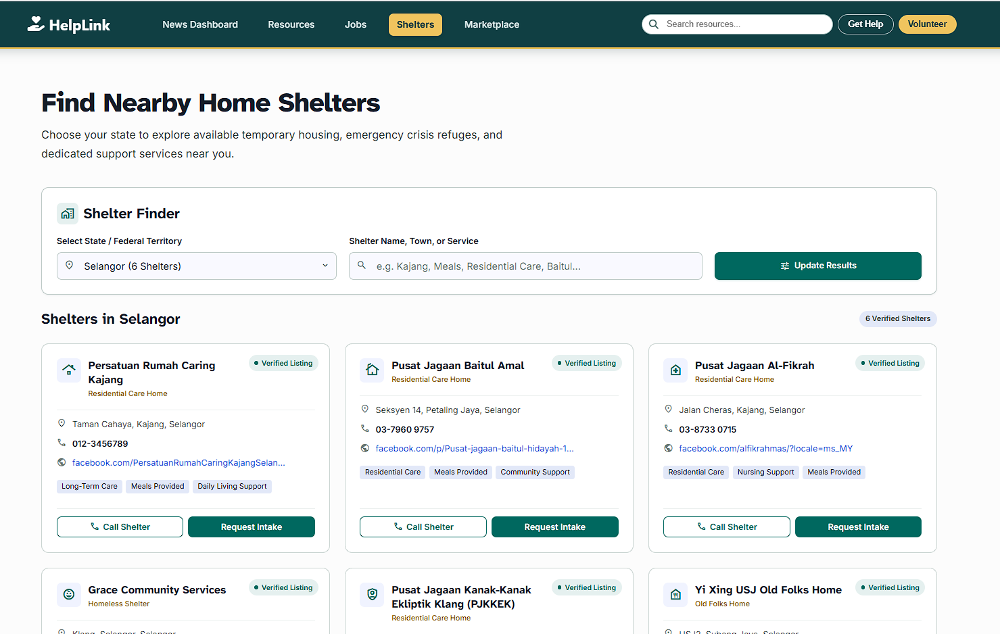
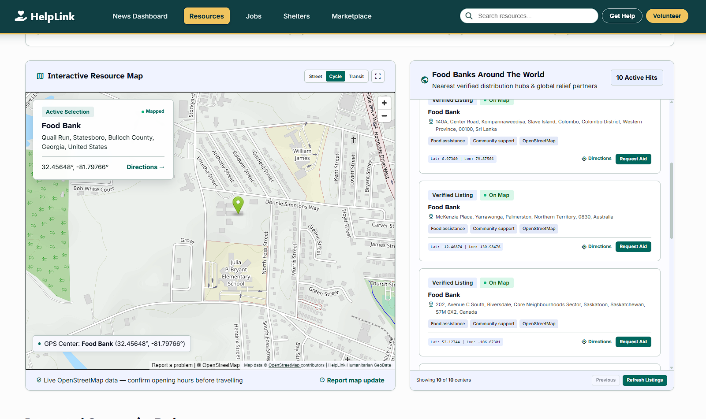
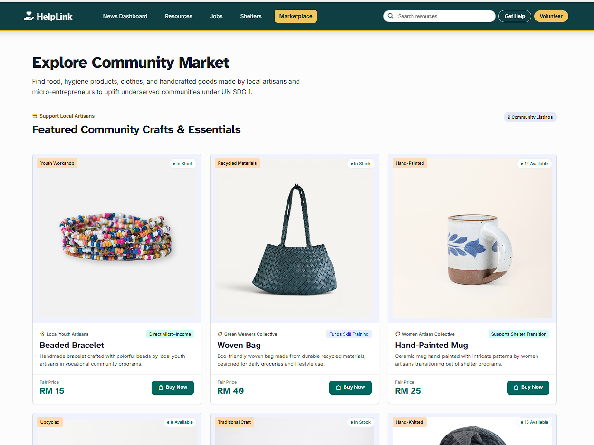
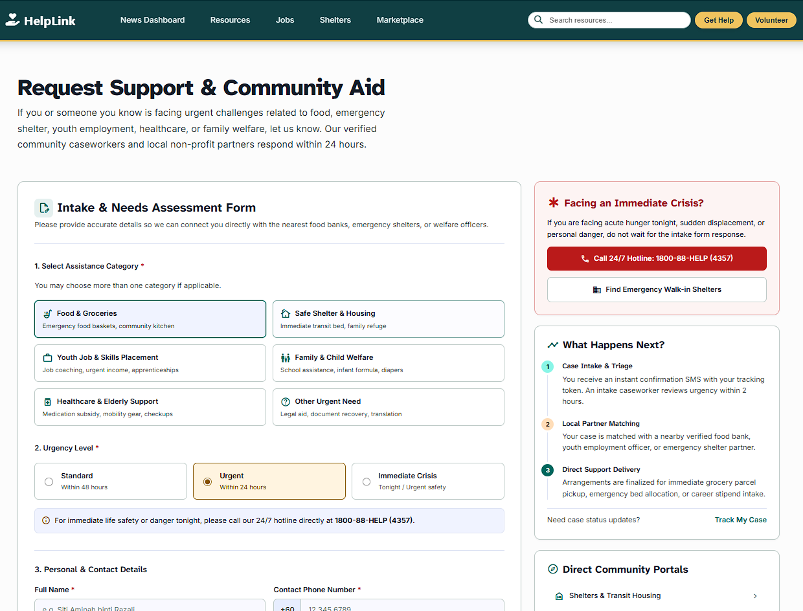
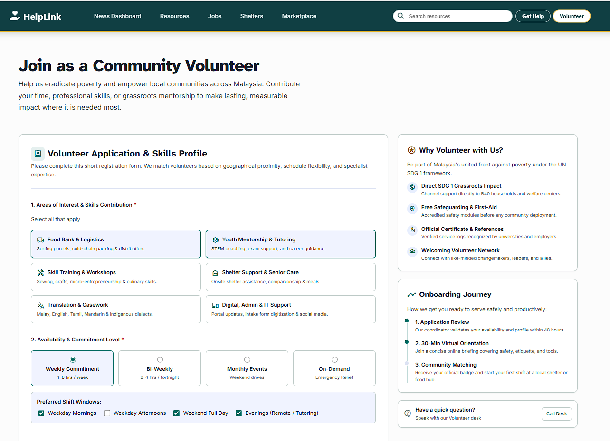

# 🌍 HelpLink — Tools and Support to End Poverty

[](https://angular.dev)
[](https://nodejs.org)
[](https://expressjs.com)
[](https://tailwindcss.com)
[](LICENSE)

> **SDG Focus:** United Nations Sustainable Development Goal 1 — _No Poverty_

**HelpLink** is a Rich Internet Application (RIA) built with **Angular 19** that connects underserved communities with real, actionable support. Instead of just raising awareness, HelpLink provides working tools — live job listings, nearby food banks, shelter directories, a community marketplace, and a full intake workflow for aid requests and volunteer onboarding.

---

## ✨ Core Features

### 📰 News & Data Dashboard

- Real-time poverty-related news articles powered by the **GNews API**, proxied server-side to keep API keys safe.
- Configurable query, language, and country filters.

### 💼 Youth Job Center

- Searchable directory of live job listings via **JSearch (RapidAPI)**.
- Filter by employment type (full-time, part-time, internship, contract).
- Sort by recency, salary, or title.
- Paginated results with employer, location, and salary details.

### 🗺️ Community Support Map

- Discover nearby food banks through **OpenStreetMap (Nominatim)**.
- Interactive embedded map with geocoded results.

### 🏠 Shelter Directory

- Filterable list of emergency and transit shelters by state/region.
- Direct contact details and capacity information.

### 🛒 Community Market

- A local marketplace for artisans and micro-entrepreneurs from underserved communities.
- Browse handcrafted goods (jewelry, bags, home & living, pantry, hygiene).
- Submit your own product for review via the **Artisan Seller Portal**.
- One-click "Buy Now" with a clear confirmation modal and purchase persistence.

### 📝 Help & Volunteer Workflows

- **Request Support** — Multi-section intake form (categories, urgency, personal details, location, situation, consent) with validation and a clear submitted/failed state.
- **Volunteer Application** — Skills, availability, shifts, motivation, and consent with the same robust state handling.
- All submissions are sent to the backend and persisted, with success/error modals instead of silent alerts.

---

## 📸 Screenshots

> Replace the placeholders below with actual screenshots of each page.

| Page                      | Screenshot                             |
| ------------------------- | -------------------------------------- |
| **Home**                  |            |
| **News Dashboard**        |            |
| **Jobs**                  |            |
| **Shelter Directory**     |     |
| **Community Support Map** |   |
| **Community Market**      |        |
| **Request Support Form**  |            |
| **Volunteer Application** |  |

---

## 🚀 Tech Stack

| Layer                  | Technology                                                                     |
| ---------------------- | ------------------------------------------------------------------------------ |
| **Frontend**           | Angular 19 (standalone components, hash-based routing, SSR via `@angular/ssr`) |
| **Styling**            | Tailwind CSS v4, Material Symbols (CDN)                                        |
| **Maps**               | OpenStreetMap (Nominatim + embedded map)                                       |
| **API Integration**    | GNews API, JSearch API (RapidAPI), OpenStreetMap Nominatim                     |
| **Backend proxy**      | Node.js / Express (`proxy-server/`) — keeps API keys server-side               |
| **Persistence (demo)** | File-based JSON storage under `proxy-server/data/`                             |

---

## 📁 Project Structure

```
HelpLink-AngularJS/
├── proxy-server/                 # Node/Express backend proxy
│   ├── server.js                 # API proxy + REST endpoints
│   ├── data/                     # Persisted JSON (help, volunteer, market)
│   ├── .env.example              # API key template
│   └── package.json
├── src/
│   └── app/
│       ├── pages/                # Route-level components
│       │   ├── home/
│       │   ├── jobs/
│       │   ├── market/
│       │   ├── help/
│       │   ├── volunteer/
│       │   ├── news/
│       │   ├── resources/
│       │   └── shelter/
│       ├── services/             # Angular HttpClient services
│       │   ├── job.service.ts
│       │   ├── foodbank.service.ts
│       │   ├── news.service.ts
│       │   ├── help.service.ts
│       │   ├── volunteer.service.ts
│       │   └── market.service.ts
│       ├── shared/
│       ├── app.routes.ts
│       └── app.config.ts
├── angular.json
├── package.json
└── README.md
```

---

## 🔐 API Keys & Security

External API keys (**GNews**, **JSearch**) are **never shipped to the browser**. All keyed API calls go through the local proxy server, which reads the keys from environment variables. HelpLink-specific endpoints (`/api/help`, `/api/volunteer`, `/api/market/*`) are served by the same proxy.

### Setup

1. **Clone the repository**

   ```bash
   git clone https://github.com/<your-org>/HelpLink-AngularJS.git
   cd HelpLink-AngularJS
   ```

2. **Install dependencies**

   ```bash
   npm install
   ```

3. **Configure API keys**

   ```bash
   cp proxy-server/.env.example proxy-server/.env
   # Edit proxy-server/.env and fill in your real keys
   ```

4. **Start the proxy server** (terminal 1)

   ```bash
   npm run start:proxy
   # or: node proxy-server/server.js
   ```

5. **Start the Angular app** (terminal 2)

   ```bash
   npm start
   ```

6. Open `http://localhost:4200` in your browser.

---

## 🌐 Backend Endpoints

The proxy exposes the following endpoints:

### External API proxies

| Method | Endpoint                       | Description                              |
| ------ | ------------------------------ | ---------------------------------------- |
| `GET`  | `/search?q=`                   | OpenStreetMap Nominatim food-bank search |
| `GET`  | `/news?q=&lang=&country=&max=` | GNews poverty news                       |
| `GET`  | `/jobs?query=&country=&page=`  | JSearch job listings                     |

### HelpLink persistence (demo)

| Method | Endpoint                | Description                     |
| ------ | ----------------------- | ------------------------------- |
| `POST` | `/api/help`             | Submit a help request           |
| `GET`  | `/api/help`             | List submitted help requests    |
| `POST` | `/api/volunteer`        | Submit a volunteer application  |
| `GET`  | `/api/volunteer`        | List volunteer applications     |
| `GET`  | `/api/market/products`  | List marketplace products       |
| `POST` | `/api/market/products`  | Submit a new product for review |
| `POST` | `/api/market/purchase`  | Record a purchase               |
| `GET`  | `/api/market/purchases` | List purchases                  |

> Persistence is file-based (JSON) under `proxy-server/data/` for demo purposes. Swap with a real database for production.

---

## 📌 Project Goals

- Provide practical, data-backed tools for addressing poverty.
- Empower users to improve their lives through skill development and employment.
- Encourage collaboration and knowledge-sharing among users and communities.
- Give every submission a clear, honest success/failure state — no silent failures.

---

## 🤝 Contributing

Contributions are welcome! Please:

1. Fork the repository.
2. Create a feature branch: `git checkout -b feature/my-feature`.
3. Commit your changes: `git commit -m "Add my feature"`.
4. Push to the branch: `git push origin feature/my-feature`.
5. Open a Pull Request.

Please keep code consistent with the existing Angular standalone-component style and Tailwind utility classes.

---

## 📄 License

This project is licensed under the **MIT License**. See the [LICENSE](LICENSE) file for details.

---

<p align="center">Built with ❤️ for UN SDG 1 — No Poverty</p>
